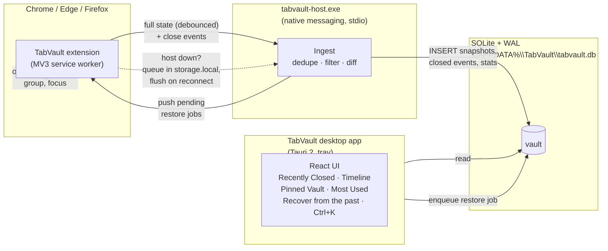

# TabVault

**Never lose a browser tab again.**

TabVault is a Windows desktop app + browser extensions (Chrome, Edge, Firefox)
that continuously records every tab and window you have open — pinned state,
tab groups, order, everything — so when a window full of tabs vanishes, you get
a toast saying *"22 tabs just closed — Restore?"* and one click brings them
all back. It also keeps a **permanent, local, searchable history** of every tab
you have ever opened or closed, and can **recover tabs you already lost** by
reading the browser's own session files.

Everything is stored locally in SQLite (in `%APPDATA%\TabVault`). No cloud, no
network, no telemetry. It works fully offline.

---

## Why

Every browser can restore your tabs *if the browser exits cleanly and the
files survive*. Accidental mass closes, crashes, profile corruption and file
rotation make that unreliable. TabVault's answer is boring and robust:
**write everything to SQLite, every 60 seconds and on every close, keep it
forever.**

## What's in the box

| Piece | Path | What it does |
|---|---|---|
| **Native host** (`tabvault-host`) | `crates/tv-host` | Tiny Rust binary the browser talks to over Chrome's native-messaging pipe. Validates, filters and writes events into the vault. |
| **Core library** (`tv-core`) | `crates/tv-core` | Schema + migrations, snapshot dedupe, retention, SNSS/mozlz4 parsers, DPAPI, history importers. Fully unit tested. |
| **Browser extensions** | `extension/` | One shared MV3 codebase → built per browser. Captures tabs/windows/groups/pins, active time, mass closes. Queues in `storage.local` when the host is down and flushes later. |
| **Desktop app** | `app/` | Tauri 2 + React. Tray-first UI: Recently Closed, Timeline, Pinned Vault, Most Used, Recover-from-the-past, Settings. |
| **Installer** | `installer/`, `app/src-tauri/nsis-hook.nsh` | NSIS (via `cargo tauri build`) installs the app + native host into `%LOCALAPPDATA%\Programs\TabVault` and registers the host for Chrome/Edge/Firefox. |

## Architecture



The restore direction flows the same path reversed: the app writes a
`restore_requests` row, the extension polls the host every ~30 s (and on every
browser event), opens the window/tabs/groups *as pinned*, and marks the job
done. Nothing ever opens a network port; the only IPC is the browser's own
native-messaging pipe plus the shared SQLite file.

## Build from source

### Prerequisites

* Windows 10/11 x64
* [Visual Studio Build Tools](https://visualstudio.microsoft.com/downloads/) (or full VS) with the **C++** workload
* Rust stable ≥ 1.82 (`rustup-init`)
* Node.js ≥ 20 + npm
* WebView2 (preinstalled on Win11, usually present on Win10)
* A normal user account. **No admin rights needed** — everything installs per-user.

### 1. Get the source

```powershell
git clone <this repository> TabVault
cd TabVault
```

### 2. Build

```powershell
# The vendored OpenSSL build needs a real Perl; fetch the portable one:
.\scripts\fetch-tools.ps1

# Verify the toolchain (MSVC + portable Perl):
. .\scripts\dev-env.ps1
```

> Why portable Perl? `rusqlite` is built with `bundled-sqlcipher-vendored-openssl`,
> which static-links OpenSSL so the shipped binary has **zero** runtime
> dependencies — no libcrypto DLL, no vcruntime requirement beyond what Rust
> already links. OpenSSL's build is Perl-driven, so a full-featured Perl must
> exist at build time. `fetch-tools.ps1` drops a portable Strawberry Perl into
> `.tools/` (nothing system-wide gets touched) and `dev-env.ps1` assembles a
> clean MSVC environment for the same reason (older GnuWin32/Cygwin toolchains
> poison the build).

```powershell
# Run all tests (schema, retention, snapshot diffing, SNSS/mozlz4 parsers):
. .\scripts\dev-env.ps1
cargo test --workspace

# Build the extension bundles for all three browsers:
cd extension
npm install
npm run build        # outputs extension/dist/{chrome,edge,firefox}

# Build the desktop app:
cd ..\app
npm install
npm run build        # UI bundle (needed by the Rust app)
cargo build --release
```

### 3. Load the extension

**Chrome / Edge** (identical flow):

1. `chrome://extensions` (or `edge://extensions`) → enable **Developer mode**.
2. Click **Load unpacked** → pick `extension/dist/chrome` (or `dist/edge`).
3. The extension appears as "TabVault". It connects to the host immediately.

**Firefox**:

1. `about:debugging` → **This Firefox** → **Load Temporary Add-on…**
2. Pick `extension/dist/firefox/manifest.json`.
3. For a permanent install, package it with `npx web-ext build` and sign it on<br>
   addons.mozilla.org (free) — or just re-load temporarily each session.

### 4. Install native host + desktop app

Two options:

**A. The installer** (recommended):

```powershell
cd app/src-tauri
cargo tauri build --bundles nsis
# produces target/release/bundle/nsis/TabVault_<version>_x64-setup.exe
```

Run the setup. It installs into `%LOCALAPPDATA%\Programs\TabVault` and
registers the native host for all three browsers automatically.

**B. Portable / developer machines:**

```powershell
cargo build --release
.\installer\scripts\register-native-host.ps1   # host manifest + Chrome/Edge/Firefox registry
```

Uninstall with `-Uninstall`.

### 5. Verify

* Chrome/Edge/Firefox toolbar → TabVault icon → popup shows
  **"host connected (v…)"**.
* Click **Snapshot now** in the popup, or watch the app's
  *Timeline* fill within a minute of browsing.
* `%APPDATA%\TabVault\tabvault.db` exists and grows.

## Lost tabs from earlier today (no extension)?

**Recover from the past** is built for exactly this.

1. Open TabVault → **Recover from the past**.
2. TabVault auto-detects every Chrome / Edge / Firefox profile on this machine
   and lists its session files and history databases.
3. Pick the files. TabVault **copies them first** (they are in use), then
   parses them:
   * **Chrome/Edge**: `Sessions/Tabs_*` and `Sessions/Session_*` (and the
     pre-Chrome-85 `Current Tabs` / `Last Tabs` / `Current Session` /
     `Last Session`) — SNSS format, pinned state included where recorded.
   * **Firefox**: `sessionstore-backups/{recovery,previous,upgrade-*}.jsonlz4`
     — decompressed with a real LZ4-block decoder.
   * History databases (`History`, `places.sqlite`) seed *visit statistics*,
     not tabs — those are labeled as history, not as open tabs.
4. Results land in **Recently Closed** with a source badge
   (`Chrome/Edge file`, `Firefox file`, …). Toggle **Group by source file** to see
   the same rows organized under one banner per imported file (file name, import
   time, tabs found in file, live-capture rows under their own banner).
   Imported pinned tabs keep their pin state end-to-end — the import report
   shows how many pinned tabs were found — so "Recover from the past" gets
   your pinned tabs back as pinned. Restore single tabs, a selection, a whole
   window, or re-pin everything from the Pinned Vault.

### Limits you should know about

* **Current Chrome/Edge (v148+)**: the newest session data is written to
  `Sessions_Encrypted/` with **App-Bound Encryption** (`v20` blobs). Those
  blobs are deliberately unreadable outside the browser; TabVault tells you so
  instead of guessing. The **cleartext mirror** in `Sessions/` (older, still
  written in current builds, and the only copy for older versions) is fully
  read and is the one to pick.
* SNSS/tab-restore files are **append-only logs**; TabVault keeps entries the
  browser would discard on replay — those *are* your lost tabs.
* Firefox's `sessionstore` is a **rolling snapshot**: it proves what was open
  at last write, plus `_closedTabs` (with timestamps) and `_closedWindows`.
* Chromium **History** is a visit log, not a session. It can resurrect your
  most-visited pages, never your exact open-tab layout.

## Using TabVault daily

| Screen | What you can do |
|---|---|
| **Recently Closed** *(home)* | Search title/URL/domain; filter by pinned-only, browser, source, date range. Restore one tab, a selection, a whole closed window (`Restore window`), or everything selected, into a new window or the current one. Skip-already-open toggle per restore. |
| **Timeline** | Browse every snapshot ever taken (minute/hour/day tiers). Preview exactly which windows, pinned tabs and groups existed at that moment. **Restore this snapshot** rebuilds it (pinned tabs re-pinned, groups recreated). |
| **Pinned Vault** | Every site you ever pinned, with first/last pinned dates and group colors. **Re-pin currently pinned** re-opens exactly what you pin today; **Re-pin everything ever pinned** re-opens the full history, pinned, with original groups. Per-row **Restore** for one site at a time. Plus a tray item: **Re-pin current pinned tabs**. |
| **Most Used** | Top sites by visit count or active time — today / this week / this month / all time. Seeded from your history database on first import. |
| **Recover from the past** | See above. |
| **Settings** | Capture interval, retention tiers, exclusion list, pause toggle, theme (dark/light/system), start-with-Windows, daily backup, encryption at rest, mass-close threshold, JSON/HTML export + seed import. |

### Keyboard

| Shortcut | Action |
|---|---|
| `Ctrl+K` | Search everything (title, domain, URL, pinned state, visit stats) |
| `Ctrl+Alt+R` | Restore the most recently closed window |
| `Alt+1` … `Alt+6` | Jump to Recently Closed / Timeline / Pinned Vault / Most Used / Recover / Settings |
| `Escape` | Close the search overlay |

## Privacy, security, and what the extension asks for

**No data ever leaves your machine.** There is no telemetry, analytics,
crash-reporting or "anonymous usage stats" code anywhere in this repository.
Network access is not needed at runtime.

* **Encryption at rest** (optional, Settings → Recording): the vault is
  re-encrypted with SQLCipher (AES-256) using a random 32-byte key wrapped by
  **Windows DPAPI** (`%APPDATA%\TabVault\key.dpapi`). Only your Windows user
  on this machine can open the vault. Plaintext export/import still works.
* **Backups**: `%APPDATA%\TabVault\backups\`, last 14 daily copies (configurable).
* **Exclusions**: domain suffix list (banking, webmail, password managers);
  incognito/private windows are skipped by default; URLs containing
  credentials in the authority section are never stored; new-tab/extension
  internal pages are never stored.
* **Permissions** the extension requests, and why each exists — see
  [`docs/PERMISSIONS.md`](docs/PERMISSIONS.md). Short version: `tabs` (read
  URLs/titles/pins/groups), `tabGroups`, `storage` (queue events offline),
  `nativeMessaging` (talk to the host), `alarms` (60-second capture timer),
  `notifications` (mass-close toast), `history` and `sessions` (optional
  first-run import buttons only, never used in the background).

## Extension stability & recovery points

* The extension sends the **full** state every minute and after any close;
  the host diffs and stores only actual changes (an idle browser writes
  nothing — the dedupe hash ignores clocks, favicons and active timers).
* If the host is down (update, crash, being installed for the first time),
  every event is queued in `storage.local` (cap 300, oldest dropped) and
  flushed on reconnect. Nothing is lost.
* **Mass-close detection**: 5+ closes in 5 s (both by the extension and
  re-checked by the host) flags the snapshot as a **Recovery Point** and fires
  a Windows toast: *"22 tabs just closed. Restore?"*
* **Restore** is best-effort per tab: one failing URL (e.g., a dead site)
  never blocks the rest of the window. Pinned tabs reopen pinned; groups are
  recreated with their names and colors. Already-open URLs are optionally
  skipped.

## Performance

SQLite (WAL, `synchronous=NORMAL`) — single writer, never blocks readers.
Indexed queries everywhere; lists are virtualized, so 100k+ closed tabs scroll
smoothly. The host does the heavy lifting; the extension is a thin collector.
Idle cost: <1% CPU, well under 100 MB RAM (TabVault measures itself; the vault
is the only state).

## Tests

```powershell
. .\scripts\dev-env.ps1
cargo test --workspace        # 70+ tests: schema/migrations, retention tiers,
                              # snapshot fingerprint/dedupe/diff, SNSS/mozlz4
                              # parsers, DPAPI, SQLCipher roundtrip, WAL
```

Plus a manual test plan for the browser bits: [`docs/MANUAL-TEST-PLAN.md`](docs/MANUAL-TEST-PLAN.md).

## Troubleshooting

| Symptom | Fix |
|---|---|
| Antivirus flags the installer | See [docs/FALSE-POSITIVE.md](docs/FALSE-POSITIVE.md) — the build is scanned clean by Windows Defender; report the false positive with the published hash; EV/OV code signing is the durable fix. |
| Windows SmartScreen blocks the installer | The binary is unsigned (no certificate). Click "More info" → "Run anyway", or report it as above. |
| Popup says "host offline" | Run `.\installer\scripts\register-native-host.ps1` (as your user, no admin). Then reload the extension's page. Details: `docs/PERMISSIONS.md`. |
| "host offline" after moving the app | Re-run the registration script with `-AppDir <new dir>` — the manifest stores an absolute path. |
| Extension runs stale code while iterating | Chrome's service worker cache lives in the *profile*. When developing with `--load-extension`, delete the profile (`C:\Users\<you>\AppData\Local\Google\Chrome\User Data\Default` is your real profile — **do not** wipe it; instead use a scratch `--user-data-dir` and delete that) or load from a fresh directory. |
| Tabs still missing after crash | Check **Recover from the past** — your last `Session_*`/`Tabs_*` files hold what survived; older SNSS generations may already be rotated away by the browser, hence TabVault's continuous capture. |
| Restore opens nothing | Check the extension is installed and `com.tabvault.host` is registered (`Get-ItemProperty HKCU:\Software\Google\Chrome\NativeMessagingHosts\com.tabvault.host`). The popup shows the error text from the host. |
| "encrypted with Chrome's App-Bound Encryption" on import | Current Chrome/Edge write that mirror under `Sessions_Encrypted/`; TabVault can't open it (only the browser can). Import the files from `Sessions/` (cleartext) instead. |
| "database is encrypted and the key was rejected" | The vault is DPAPI-encrypted and the key blob next to it is missing/corrupt. Restore `%APPDATA%\TabVault\vault.db` **and** `key.dpapi` from a backup together, or restore plaintext from `backups/`. |
| Encrypted files copied with `-wal`/`-shm` fail to open | We copy siblings too, deliberately — if that copy is inconsistent, retry the copy with the browser closed. |
| Build fails: `'perl' is not recognized` | Run `scripts/fetch-tools.ps1` once, then build with `. .\scripts\dev-env.ps1` in the same shell. |
| Build fails with `C:\Program ... not recognized` | A stale `make=C:\Program Files (x86)\GnuWin32\bin` (or Cygwin) environment variable is poisoning OpenSSL's build. `dev-env.ps1` scrubs it; run builds through it. |

## License

MIT. See [LICENSE](LICENSE).
